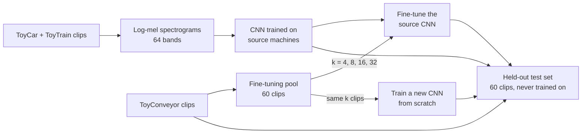

# Transfer Learning for Machine-Sound Fault Detection

**A fault detector trained on two machines fails on a third, new machine: it flags every clip as faulty (50% accuracy). Does fine-tuning it on a handful of the new machine's clips beat training from scratch on those same clips? On average yes, at every amount of data tried (+4 to +15 points), but with 10 confirmatory seeds no single difference is statistically significant: on training sets this small, both approaches swing by ±13–22 points from seed to seed.** The repository is built to measure that honestly: a test set no model trains on, a from-scratch control, paired confidence intervals, and separate development and confirmatory seeds.

[](https://github.com/dojedaro/transfer-learning-audio-anomaly-detection/actions/workflows/ci.yml)


## The question

Commissioning a new machine is when a fault detector is weakest: there are many labeled recordings
from the machines you already monitor and almost none from the new one. Does a model trained on the
old machines help, and how much new-machine data does it save?

## Results

Confirmatory run (seeds 10–19; each seed regenerates the audio, the splits and the training order).
Accuracy on **60 held-out conveyor clips (30 normal, 30 faulty) that no model trains on**, mean ±
sample standard deviation:

| Labeled conveyor clips | Trained from scratch | Fine-tuned from car/train model | Paired gain, 95% CI | Fine-tuning wins / loses |
|---|---|---|---|---|
| 0 (car/train model as is) | – | 50.0% ± 0.0 | – | – |
| 4 | 60.2% ± 13.0 | 75.5% ± 21.3 | +15.3 (−6.1 to +36.8) | 6 / 4 |
| 8 | 65.5% ± 15.2 | 74.5% ± 20.1 | +9.0 (−9.0 to +27.0) | 5 / 5 |
| 16 | 73.7% ± 20.6 | 77.5% ± 19.3 | +3.8 (−14.2 to +21.9) | 5 / 4 |
| 32 | 78.3% ± 21.8 | 91.0% ± 13.5 | +12.7 (−7.5 to +32.9) | 6 / 3 |

The paired gain is fine-tuned minus from-scratch accuracy on the same seed and the same clips;
the interval is a t-interval over the 10 seeds.

- **Domain shift is real.** On held-out clips from its own machines the source model scores 100%;
  on the conveyor it calls every clip faulty (F1 0.67, accuracy exactly 50%).
- **Fine-tuning is ahead on average at every k, but not significantly.** Every interval includes
  zero. The development run (seeds 0–9, below) showed a large, consistent gain with 4 clips (+22
  points, 9 of 10 seeds); on fresh seeds the gain at 4 clips is smaller and wins only 6 of 10.
- **The limiting factor is variance, not the method.** With 4 to 32 training clips, a single seed's
  accuracy moves by 20 points depending on which clips were drawn. Showing a reliable difference
  would need many more seeds or larger target sets.

## How it works



- **Data** ([`synth.py`](src/machine_audio/synth.py)): 4-second, 16 kHz clips of a machine hum
  (fundamental plus harmonics, load drift, noise). Faulty clips add 50 ms impulsive bursts, the
  usual signature of a chipped gear or a bearing defect. By design, the conveyor hums at a
  different pitch, is noisier, and faults with quieter bursts in a different band (0.8–1.4 kHz
  instead of 2–3 kHz).
- **Model** ([`model.py`](src/machine_audio/model.py)): three conv blocks with GroupNorm (the target
  training sets are as small as 4 clips, where BatchNorm is unstable), global average pooling and
  one logit.
- **Protocol** ([`experiment.py`](src/machine_audio/experiment.py)): the conveyor clips are split,
  stratified by label, into a fine-tuning pool and a disjoint test set; every arm uses the same
  preprocessing (standardized with statistics from the source training clips only) and a fixed
  training schedule; both arms see the same k clips. Nothing is tuned on the test set.

## Development and confirmatory seeds

Seeds 0–9 were used while building the protocol. A first 2-seed smoke run exposed BatchNorm
collapsing on 4-clip training sets and fine-tuning barely moving the weights at a 1e-4 learning
rate, so normalization became GroupNorm, the fine-tuning rate 3e-4 and the schedules longer. That
choice was informed by seeing fine-tuning underperform, so the from-scratch arm was not given the
same attention. The test split was also made stratified after review. The code was then frozen and
run once on fresh seeds 10–19: those are the results above.

The development run is kept in [`results/development/`](results/development/) for transparency:
fine-tuning beat training from scratch by 22 points with 4 clips (9 of 10 seeds) and by 6–12 points
with 8–32 clips. The confirmatory run shows a smaller and less consistent effect, which is the
number to trust.

## Run it

Runs on a laptop CPU in about 10 minutes for 10 seeds; no GPU or download needed.

```bash
pip install -e ".[dev]"
python -m machine_audio.experiment --out results            # confirmatory seeds 10-19
python -m machine_audio.plot --results results
pytest
```

## Limitations

- **The audio is synthetic.** Machine names follow the [ToyADMOS](https://github.com/YumaKoizumi/ToyADMOS-dataset)
  dataset, but no ToyADMOS recordings are used, and the domain shift is designed, not measured.
  The next step is the same protocol on real ToyADMOS or MIMII recordings.
- **Underpowered.** 10 seeds and 60 test clips per seed cannot resolve gains of 5–15 points against
  this much seed-to-seed variance.
- **Supervised framing.** Real anomaly detection usually trains on normal sounds only
  (autoencoders, one-class models), because labeled faults are rare. This project assumes a few
  labeled faults exist for the new machine.

## Earlier version

The first version of this repository (a Colab notebook) reported 50% → 94% for transfer. That 94%
was not a held-out result: the model was fine-tuned on 54 of the 66 conveyor clips it was then
scored on, and there was no from-scratch control. This rebuild fixes both. The original notebook is
in the git history.

## Stack

Python, PyTorch, librosa, NumPy, SciPy, scikit-learn, Matplotlib; pytest and ruff in CI.

## License

MIT
