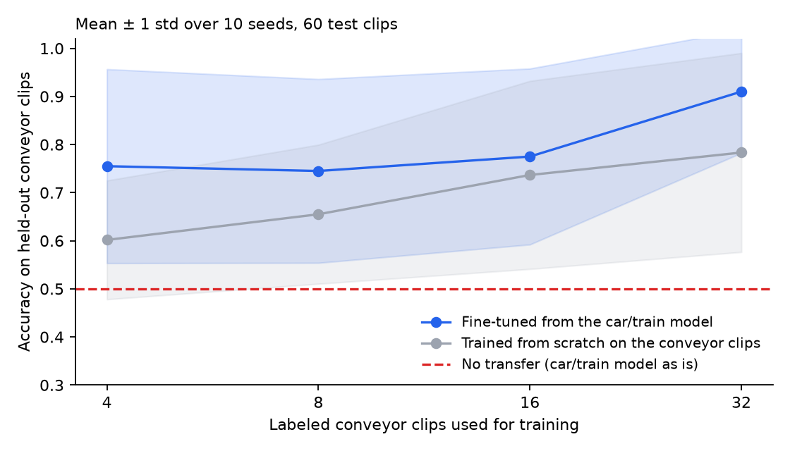
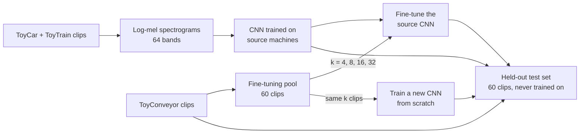

# Transfer Learning for Machine-Sound Fault Detection

**A fault detector trained on two machines is no better than a coin flip on a third, new machine (52%). Fine-tuning it on just 4 labeled clips of the new machine reaches 76%, against 54% for the same 4 clips trained from scratch. The gap narrows, and gets noisier, as more target data is available: 93% vs. 82% with 32 clips.**

[](https://github.com/dojedaro/transfer-learning-audio-anomaly-detection/actions/workflows/ci.yml)



## The question

Commissioning a new machine is when a fault detector is weakest: there are many labeled recordings
from the machines you already monitor and almost none from the new one. Does a model trained on
the old machines help, and how much new-machine data does it save?

## Results

Accuracy on **60 held-out conveyor clips that no model trains on**, mean ± std over 10 seeds
(each seed regenerates the data, the splits and the training order):

| Labeled conveyor clips | Trained from scratch | Fine-tuned from car/train model | Seeds where fine-tuning wins |
|---|---|---|---|
| 0 (car/train model as is) | – | 51.8% ± 4.4 | – |
| 4 | 54.3% ± 10.4 | **76.0% ± 12.9** | 9 of 10 |
| 8 | 68.2% ± 15.4 | **77.2% ± 13.3** | 6 of 10 (1 tie) |
| 16 | 69.2% ± 18.4 | **74.8% ± 15.3** | 5 of 10 |
| 32 | 81.8% ± 17.3 | **93.3% ± 6.5** | 5 of 10 (2 ties) |

On their own machines the source model scores 100% on held-out clips, so the 52% is not a weak
model; it is domain shift.

- **The source model has the right idea in the wrong place.** It learned "short bursts against a
  steady hum" at 2–3 kHz; the conveyor's faults are quieter bursts at 0.8–1.4 kHz, so it misses them.
- **Transfer pays off most when data is scarcest.** With 4 clips, fine-tuning wins on 9 of 10 seeds
  by 22 points on average. From 8 clips on, the average advantage is 6–12 points but individual
  seeds go either way: with 60 test clips one seed's accuracy moves in 1.7-point steps, and small
  training sets make both arms unstable.
- **Fine-tuning is also more reliable:** at 32 clips its spread across seeds is 6.5 points against
  17.3 for training from scratch.

## How it works



- **Data** ([`synth.py`](src/machine_audio/synth.py)): 4-second, 16 kHz clips of a machine hum
  (fundamental plus harmonics, load drift, noise). Faulty clips add 50 ms impulsive bursts, the
  usual signature of a chipped gear or a bearing defect. The conveyor hums at a different pitch, is
  noisier, and its faults sit in a different frequency band at lower amplitude.
- **Model** ([`model.py`](src/machine_audio/model.py)): three conv blocks with GroupNorm (the target
  training sets are as small as 4 clips, where BatchNorm is unstable), global average pooling and
  one logit.
- **Protocol** ([`experiment.py`](src/machine_audio/experiment.py)): every arm uses the same
  preprocessing (standardized with statistics from the source training clips only) and a fixed
  training schedule. Nothing is tuned on the test set. Fine-tuning uses a 3x smaller learning rate
  than training from scratch.

## Run it

Runs on a laptop CPU in about 10 minutes for 10 seeds; no GPU or download needed.

```bash
pip install -e ".[dev]"
python -m machine_audio.experiment --out results --seeds 10
python -m machine_audio.plot --results results
pytest
```

## Limitations

- **The audio is synthetic.** Machine names follow the [ToyADMOS](https://github.com/YumaKoizumi/ToyADMOS-dataset)
  dataset, but no ToyADMOS recordings are used, and the domain shift is designed, not measured.
  The next step is the same protocol on real ToyADMOS or MIMII recordings, where faults are subtler.
- **Supervised framing.** Real anomaly detection usually trains on normal sounds only
  (autoencoders, one-class models), because labeled faults are rare. This project assumes a few
  labeled faults exist for the new machine.
- **Small test set.** 60 clips per seed; the 10-seed spread is reported for that reason.
- **One round of design changes after a smoke run.** A first 2-seed run (seeds 0 and 1, which are
  also in the final 10) showed BatchNorm collapsing on 4-clip training sets and fine-tuning barely
  moving the weights at a 1e-4 learning rate. Normalization became GroupNorm, the fine-tuning rate
  3e-4 and the schedules a little longer; the settings were then frozen before the 10-seed run.
  No other settings were tried.

## Earlier version

The first version of this repository (a Colab notebook) reported 50% → 94% for transfer. That 94%
was not a held-out result: the model was fine-tuned on 54 of the 66 conveyor clips it was then
scored on. This rebuild fixes that with a disjoint test set, adds the from-scratch control that the
original lacked, and reports the spread over seeds. The original notebook is in the git history.

## Stack

Python, PyTorch, librosa, NumPy, scikit-learn, Matplotlib; pytest and ruff in CI.

## License

MIT
