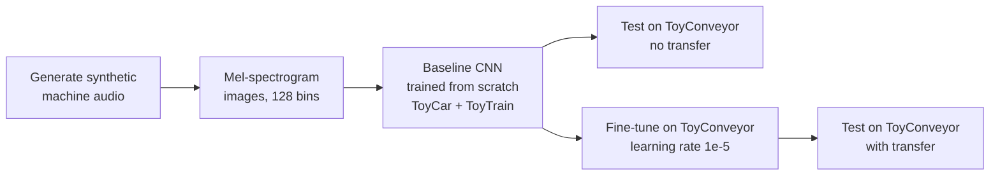

# Transfer Learning for Machine-Sound Anomaly Detection

**Does a CNN trained to hear faults in toy cars and trains transfer to a conveyor belt it has never heard? Not on its own: it scores 50%, a coin flip. Fine-tuned on a little conveyor data, it reaches 94%.**

[](https://colab.research.google.com/github/dojedaro/transfer-learning-audio-anomaly-detection/blob/main/Audio%20Data%2C%20ResNet%20and%20Transfer%20Learning.ipynb)
[](https://github.com/dojedaro/transfer-learning-audio-anomaly-detection/actions/workflows/notebooks.yml)

## Results

Normal vs. anomalous machine sounds, as mel-spectrogram images. The headline experiment trains on
ToyCar and ToyTrain and tests on ToyConveyor, a machine type the model never saw.

| Setup | Trained on | Tested on | Test clips | Accuracy | F1 |
|---|---|---|---|---|---|
| Random split (sanity check) | all machines | all machines | 123 | 1.000 | 1.000 |
| No transfer | ToyCar + ToyTrain | ToyConveyor | 66 | 0.500 | **0.000** |
| Transfer + fine-tuning | the model above, fine-tuned on ToyConveyor (lr 1e-5) | ToyConveyor | 66 | **0.939** | **0.943** |

- **Without transfer the model collapsed.** 50% accuracy with an F1 of 0 means it predicted "normal"
  for every conveyor clip. Training accuracy reached 100% while validation sat at exactly 50% for
  every epoch: it memorized car and train sounds and learned nothing general about "anomalous".
- **A small amount of target data fixes it.** Fine-tuning the same weights at a low learning rate
  lifts conveyor accuracy from 0.50 to 0.94.
- **The random split is too easy to mean much.** 100% when every machine is in both train and test
  says the anomalies are separable, not that the model generalizes.

**About the data:** the audio is *synthetic*, generated to mimic the structure of the
[ToyADMOS](https://github.com/YumaKoizumi/ToyADMOS-dataset) dataset (16 kHz, 10 s clips, anomalies
injected as frequency distortions and noise). Real ToyADMOS recordings would be harder, and the test
set is small (66 clips), so treat these as a clear demonstration of the effect, not a benchmark.

## How it works



The CNN has 4 convolutional blocks with batch normalization and max pooling, followed by dense layers
with dropout (about 19M trainable parameters). Transfer reuses all weights and continues training on
the target machine at a 100x lower learning rate, so it adapts without forgetting what it learned.

## Run it

Runs on Google Colab with a GPU. The notebook generates its own data, so no download is needed.

```bash
pip install -r requirements.txt
jupyter notebook "Audio Data, ResNet and Transfer Learning.ipynb"
```

Outside Colab, change the Google Drive paths at the top to a local folder.

## Stack

Python, librosa, NumPy, SciPy, TensorFlow/Keras, scikit-learn, Matplotlib.

## Limitations and next steps

- Repeat on the **real ToyADMOS** recordings, where anomalies are subtle.
- Freeze the convolutional layers and fine-tune only the head, to measure how much target data
  transfer really saves.
- Anomaly detection is usually trained on normal sounds only (autoencoders, one-class models).
  This project frames it as supervised classification, which assumes labeled anomalies exist.

## License

MIT
